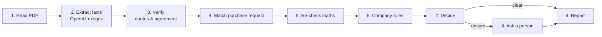

# Supplier Quote Checker

AI pipeline that checks supplier quotations against a purchase request and company rules: **Approve**, **Reject** or **Needs a person to check**, with exact quotes from the document as evidence. Built with LangGraph.

- **Live demo:** _add your Streamlit Cloud link here_
- **One-page note:** [NOTE.md](NOTE.md)

## What it does

A garment company (Aamar Garments Ltd, fictional) receives quotations and contract terms from suppliers. For each supplier PDF the checker:

1. reads the quote and pulls out the supplier, item, quantity, price, delivery period, payment terms, VAT, TIN/BIN, penalty clause and validity,
2. compares it with the purchase request (wrong quantity or price),
3. checks the terms against the company rules ([data/company-rules.md](data/company-rules.md)),
4. gives one answer with the reasons, quoting the exact text that supports each reason,
5. **stops and asks a person when it is not sure.** It never guesses.

## Results on the 10 sample packs

| Pack | Supplier | Decision | Reason |
|---|---|---|---|
| 01 | Padma Textile Mills Ltd | Approve | All rules pass |
| 02 | Jamuna Trims and Accessories | Approve | All rules pass |
| 03 | Karnaphuli Yarn Traders | Reject | R1: price 229.00 is 9.05% above max 210.00 |
| 04 | Surma Packaging Industries | Needs a person | N1: price 6.65 is 2.31% above max 6.50 |
| 05 | Meghna Carton Works | Reject | R2: 40% advance (wording duplicated; every reading > 20%) |
| 06 | Teesta Fabrics Ltd | Reject | R3: no late-delivery penalty clause |
| 07 | Rupsha Zipper Factory | Needs a person | N2: quantity 16,500 vs 20,000 requested (−17.5%) |
| 08 | Bhairab Thread and Co | Reject | R4: TIN/BIN missing ("available on request") |
| 09 | Dhaleshwari Poly Pack | Needs a person | N6: line amount wrong by 2,000; N3: payment "30 to 90 days as agreed" |
| 10 | Kushiyara Box Industries | Reject | R5: delivery 60 days; N5: VAT not shown separately |

| Mode | Decisions right | Decision + reason right | Avg time / pack |
|---|---|---|---|
| Live: OpenAI `gpt-4o-mini` + regex cross-check (2 runs) | **10/10** | **10/10** | ~7 s |
| Offline: regex only | **10/10** | **10/10** | ~0.1 s |

The verify step earns its place. Even with the final prompt, the LLM claimed pack 08's penalty is "% of order value" (the clause does not say so), and it reported a subtotal for pack 10, which has none. Both were caught and not trusted. With the first prompt version the LLM made up quotes such as `"Qty 800"` by joining a column header to a value; these were rejected too, and the score was 8/10 (2 clean packs sent to a person, never wrongly approved).

## How it works

A fixed pipeline of small steps (no free-running agent). The AI only **reads**; every number and every rule is checked by **plain Python**; anything uncertain goes to a **person**.



| Step | File | What it does |
|---|---|---|
| 1 Read | [checker/parse.py](checker/parse.py) | PDF → text with pdfplumber |
| 2 Extract | [checker/extract_llm.py](checker/extract_llm.py), [checker/extract_regex.py](checker/extract_regex.py) | OpenAI returns structured JSON: every field has a value, the **exact quote** it came from, and a status (FOUND / NOT_FOUND / UNCLEAR). A regex extractor reads the same document independently. |
| 3 Verify | [checker/verify.py](checker/verify.py) | A value is trusted only if (a) its quote really appears in the PDF, (b) the value is inside that quote, and (c) the regex extractor read the same value. Otherwise it becomes UNCLEAR and the invented value is thrown away. |
| 4 Match | [checker/match.py](checker/match.py) | Finds the purchase-request line; checks item, unit and PR number |
| 5 Maths | [checker/math_check.py](checker/math_check.py) | qty × price, subtotal, VAT 15%, total, done with `Decimal` |
| 6 Rules | [checker/rules.py](checker/rules.py) | Each company rule is a small function: PASS / FAIL / UNKNOWN, with evidence |
| 7 Decide | [checker/decide.py](checker/decide.py) | Any Reject rule → **Reject**; else any Needs-check rule, anything UNKNOWN or any error → **Needs a person**; else **Approve** |
| 8 Person | [checker/graph.py](checker/graph.py) | LangGraph `interrupt()` pauses the pipeline until a person answers in the app |
| 9 Report | [checker/report.py](checker/report.py) | JSON + Markdown with reasons and quotes |

### Why it is built this way

- **LLMs are good at reading messy text, bad at arithmetic and at noticing what is missing.** So the LLM only extracts, and code does every comparison. The LLM is never asked "should we approve this?".
- **"Never guess" is enforced in code, not just in the prompt:** a value with no quote, a quote not found in the PDF, or a disagreement between the two extractors all become UNCLEAR, and UNCLEAR can never lead to Approve.
- **A failed step never crashes the run.** It is recorded and the pack goes to a person. Even a clear Reject is sent to a person if the LLM step failed, because only one extractor was used.
- **Rule thresholds live in [config.yaml](config.yaml).** Changing a company rule is a one-line edit.

## Quick start

Requires Python 3.10+.

```bash
pip install -r requirements.txt

# 1. Offline, no API key needed
python evaluate.py --mode regex

# 2. With OpenAI
cp .env.example .env          # then put your OPENAI_API_KEY in .env
python evaluate.py --mode live

# 3. The web app
streamlit run app.py

# Tests (68 tests: rule boundaries, hallucination checks, pipeline, human review)
python -m pytest -q
```

Run on any PDF and see full reasons:

```bash
python run.py data/supplier-pack-05.pdf --details
python run.py                     # all packs; writes outputs/results.json and outputs/report.md
```

### Modes

| Mode | What reads the document | Needs API key |
|---|---|---|
| `live` | OpenAI + regex cross-check. Answers are saved in `cache/llm/`. | yes |
| `replay` | The saved OpenAI answers + regex cross-check | no |
| `regex` | Regex extractor only | no |
| `auto` (default) | `live` if a key is set, else `replay` if a saved answer exists, else `regex` | – |

Run `python evaluate.py --mode live` once and commit `cache/llm/`. After that, anyone can reproduce the LLM results with `--mode replay` without a key.

## Deploy on Streamlit Community Cloud

1. Push this repo to GitHub (public).
2. On [share.streamlit.io](https://share.streamlit.io): **Create app** → pick the repo, branch `main`, main file `app.py`. Under **Advanced settings** pick Python 3.12.
3. In **Secrets** add:
   ```toml
   OPENAI_API_KEY = "sk-..."
   ```
4. Deploy. The key stays in Streamlit's secrets; it is never in the code.

## Project structure

```
checker/          the pipeline (one file per step) + graph.py (LangGraph wiring)
data/             the 10 sample packs, purchase request, company rules
cache/llm/        saved OpenAI answers (for replay mode)
tests/            expected.csv (answer key) + pytest suite
app.py            Streamlit app (run, inspect, human review)
run.py            command line runner
evaluate.py       score against tests/expected.csv
config.yaml       rule thresholds, model, mode
```

## Assumptions (where the rules are not explicit)

| Situation | What the checker does |
|---|---|
| Exactly 3% over price, exactly 20% advance, exactly 45 days, exactly 30 days validity | Allowed ("more than" / "less than" are strict) |
| Penalty present but below 0.5% per week, or not stated as % of order value | Needs a person (P1) |
| Price quoted including VAT (pack 10) | Compared as quoted (the stricter reading) and flagged under N5 |
| "4 weeks" | 28 days |
| Payment "30 to 90 days as agreed" | Unclear → Needs a person |
| Advance stated twice (pack 05: 40% + 40%) | Unclear, but Reject because even the lowest reading (40%) is over 20% |
| Document with no item line at all | Needs a person (not Reject): it may not be a quotation |

## Limitations

See [NOTE.md](NOTE.md). In short: text PDFs only (no OCR), one item per quotation, the regex extractor is tuned to this document layout, and the human-review answers are kept in memory only.
