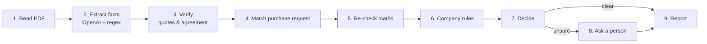

# Supplier Quote Checker

AI pipeline that checks supplier quotations against a purchase request and company rules: **Approve**, **Reject** or **Needs a person to check**, with exact quotes from the document as evidence. Built with LangGraph.

- **Live demo:** _add your Streamlit Cloud link here_
- **One-page note:** [NOTE.md](NOTE.md)

## What it does

A garment company (Aamar Garments Ltd, fictional) receives quotations and contract terms from suppliers. For each supplier PDF the checker:

1. reads the quote and pulls out the supplier, item, quantity, price, delivery period, payment terms, VAT, TIN/BIN, penalty clause and validity,
2. compares it with the purchase request (wrong quantity or price),
3. checks the terms against the company rules ([data/company-rules.md](data/company-rules.md)),
4. gives one answer with the reasons, quoting the exact text that supports each reason,
5. **stops and asks a person when it is not sure.** It never guesses.

## Results on the 10 sample packs

| Pack | Supplier | Decision | Reason |
|---|---|---|---|
| 01 | Padma Textile Mills Ltd | Approve | All rules pass |
| 02 | Jamuna Trims and Accessories | Approve | All rules pass |
| 03 | Karnaphuli Yarn Traders | Reject | R1: price 229.00 is 9.05% above max 210.00 |
| 04 | Surma Packaging Industries | Needs a person | N1: price 6.65 is 2.31% above max 6.50 |
| 05 | Meghna Carton Works | Reject | R2: 40% advance (wording duplicated; every reading > 20%) |
| 06 | Teesta Fabrics Ltd | Reject | R3: no late-delivery penalty clause |
| 07 | Rupsha Zipper Factory | Needs a person | N2: quantity 16,500 vs 20,000 requested (−17.5%) |
| 08 | Bhairab Thread and Co | Reject | R4: TIN/BIN missing ("available on request") |
| 09 | Dhaleshwari Poly Pack | Needs a person | N6: line amount wrong by 2,000; N3: payment "30 to 90 days as agreed" |
| 10 | Kushiyara Box Industries | Reject | R5: delivery 60 days; N5: VAT not shown separately |

| Mode | Decisions right | Decision + reason right | Avg time / pack |
|---|---|---|---|
| Live: OpenAI `gpt-4o-mini` + regex cross-check (2 runs) | **10/10** | **10/10** | ~7 s |
| Offline: regex only | **10/10** | **10/10** | ~0.1 s |

The verify step earns its place. Even with the final prompt, the LLM claimed pack 08's penalty is "% of order value" (the clause does not say so), and it reported a subtotal for pack 10, which has none. Both were caught and not trusted. With the first prompt version the LLM made up quotes such as `"Qty 800"` by joining a column header to a value; these were rejected too, and the score was 8/10 (2 clean packs sent to a person, never wrongly approved).

## How it works

A fixed pipeline of small steps (no free-running agent). The AI only **reads**; every number and every rule is checked by **plain Python**; anything uncertain goes to a **person**.



| Step | File | What it does |
|---|---|---|
| 1 Read | [checker/parse.py](checker/parse.py) | PDF → text with pdfplumber |
| 2 Extract | [checker/extract_llm.py](checker/extract_llm.py), [checker/extract_regex.py](checker/extract_regex.py) | OpenAI returns structured JSON: every field has a value, the **exact quote** it came from, and a status (FOUND / NOT_FOUND / UNCLEAR). A regex extractor reads the same document independently. |
| 3 Verify | [checker/verify.py](checker/verify.py) | A value is trusted only if (a) its quote really appears in the PDF, (b) the value is inside that quote, and (c) the regex extractor read the same value. Otherwise it becomes UNCLEAR and the invented value is thrown away. |
| 4 Match | [checker/match.py](checker/match.py) | Finds the purchase-request line; checks item, unit and PR number |
| 5 Maths | [checker/math_check.py](checker/math_check.py) | qty × price, subtotal, VAT 15%, total, done with `Decimal` |
| 6 Rules | [checker/rules.py](checker/rules.py) | Each company rule is a small function: PASS / FAIL / UNKNOWN, with evidence |
| 7 Decide | [checker/decide.py](checker/decide.py) | Any Reject rule → **Reject**; else any Needs-check rule, anything UNKNOWN or any error → **Needs a person**; else **Approve** |
| 8 Person | [checker/graph.py](checker/graph.py) | LangGraph `interrupt()` pauses the pipeline until a person answers in the app |
| 9 Report | [checker/report.py](checker/report.py) | JSON + Markdown with reasons and quotes |

### Why it is built this way

- **LLMs are good at reading messy text, bad at arithmetic and at noticing what is missing.** So the LLM only extracts, and code does every comparison. The LLM is never asked "should we approve this?".
- **"Never guess" is enforced in code, not just in the prompt:** a value with no quote, a quote not found in the PDF, or a disagreement between the two extractors all become UNCLEAR, and UNCLEAR can never lead to Approve.
- **A failed step never crashes the run.** It is recorded and the pack goes to a person. Even a clear Reject is sent to a person if the LLM step failed, because only one extractor was used.
- **Rule thresholds live in [config.yaml](config.yaml).** Changing a company rule is a one-line edit.

## Quick start

Requires Python 3.10+.

```bash
pip install -r requirements.txt

# 1. Offline, no API key needed
python evaluate.py --mode regex

# 2. With OpenAI
cp .env.example .env          # then put your OPENAI_API_KEY in .env
python evaluate.py --mode live

# 3. The web app (http://localhost:8501)
streamlit run app.py

# Tests (200 tests, no credentials needed)
python -m pytest -q
```

Run on any PDF and see full reasons:

```bash
python run.py data/supplier-pack-05.pdf --details
python run.py                     # all packs; writes outputs/results.json and outputs/report.md
```

### Modes

| Mode | What reads the document | Shown as | Needs API key |
|---|---|---|---|
| `auto` (default) | **Live** if an OpenAI key is set, otherwise **regex only**. Never uses recorded responses. | Live AI Analysis / AI unavailable — Regex-only analysis | – |
| `live` | A real OpenAI call for every document + regex cross-check. Without a key (or if the call fails) it falls back to regex only and the document goes to a person. | Live AI Analysis | yes |
| `regex` (Offline) | Regex extractor only, no network | AI unavailable — Regex-only analysis | no |
| `replay` (**testing only**) | Recorded OpenAI responses + regex cross-check. Only when chosen explicitly: `--mode replay`, or Settings → *Developer / testing options*. | Recorded AI Response — Not Live | no |

Every result records how it was made (`extraction_source`), and the UI shows it as a badge on the monitor,
the document details and the review workspace, so a recorded response is never presented as fresh AI analysis.

Recordings are the answers your own earlier live runs saved (Supabase `llm_cache`, or `cache/llm/` locally).
No recorded answers ship with the repository, and recordings are git-ignored. A recording is matched by the
exact document text (and prompt version), so it can never be used for a different PDF; a document without one
gets regex-only analysis. Every pipeline step after extraction (quote verification against the PDF, LLM vs
regex cross-check, maths, the 14 rules, the decision) runs again in every mode. Auto mode never reads recordings.

## The web app

`streamlit run app.py` opens **Supplier Intelligence**, a multi-page dashboard:

| Page | What it shows |
|---|---|
| Overview | Totals, approval/rejection/review counts, success rate, average time, recent activity, charts. All computed from processed documents. |
| Document Processing | Add the 10 samples or upload PDFs → queue with size and validation → **Start processing** → live monitor. |
| All Documents | Every document with full details: evidence quotes, all 24 extracted fields (click a row for the exact quote), all rule results, extracted text, PDF preview, processing log. |
| Validation Results | Rule matrix (documents × rules) and rule-failure chart per batch. |
| Human Review | Documents the system would not decide. Approve/Reject with a reason; this resumes the paused LangGraph run. |
| Processing History | Past batches and documents, filterable by date, supplier, decision, mode and status. |
| Settings | Mode (Auto / Live / Offline; Replay only under *Developer / testing options*), OpenAI model and connection test, rule thresholds, storage. |

### How the live monitor works

- **One background thread per batch** processes the documents one at a time, in order
  ([service/batch.py](service/batch.py)). The page is never blocked: you can open finished results, or go to
  another page, while the next PDF runs.
- **Progress comes from LangGraph itself.** `graph.stream(..., stream_mode="tasks")` reports when each node starts
  and finishes, with its output. [service/progress.py](service/progress.py) turns these into events. Each UI stage
  is exactly one graph node (Read & validate PDF → Extract fields → Cross-validate → Match purchase request →
  Re-check arithmetic → Evaluate company rules → Decide → Human review → Report). Nothing is simulated.
- The monitor redraws once per second with `st.fragment(run_every=1)` from a thread-safe snapshot. It shows the
  batch progress, a card per document with its stage track, the current document's details, and the live log.
- **Cancel** stops after the current document. A document is never stopped half-way.
- If a document fails (e.g. corrupted PDF), the failure is recorded at the stage where it happened, the document
  goes to a person, and the batch continues with the next one.

### Human review and persistence

- A *Needs review* document pauses at the `human_review` node (`interrupt()`). Submitting a decision calls
  `Command(resume={"decision", "comment"})` on that document's own thread. A database claim blocks double
  submissions.
- History, events, step checkpoints, the LangGraph state and the original PDFs are stored in **Supabase**
  when it is configured (see below), otherwise locally under `runtime/` (not in git). Either way a document
  waiting for review can still be reviewed after the app restarts. Work that was running when the app stopped is
  marked *interrupted* and can be re-queued from Processing History (its PDF is in storage).

## Persistent storage with Supabase

Without configuration the app stores everything locally (`runtime/`), which Streamlit Community Cloud deletes on
every reboot. With Supabase, history and PDFs are permanent.

| What | Where (Supabase) | Local fallback |
|---|---|---|
| Batches, documents (all 24 fields, rules, quotes in `result_json`), events, step checkpoints, LLM cache | PostgreSQL tables `batches`, `documents`, `document_events`, `pipeline_checkpoints`, `llm_cache` | `runtime/app.db` (SQLite, same SQL) |
| Paused review pipelines (LangGraph state) | PostgreSQL, LangGraph `PostgresSaver` tables | `runtime/graph-checkpoints.db` |
| Original PDFs | Private Storage bucket `supplier-documents`, path `pdfs/<sha256[:2]>/<sha256>.pdf` | `runtime/files/` |

### 1. Create the project
On [supabase.com](https://supabase.com) → **New project**. Note the database password.

### 2. PostgreSQL connection
**Project Settings → Database → Connection string → Session pooler** (URI), with your database password filled in. If the password contains special characters (`@ # ! * : /` …), percent-encode them (for example `@` → `%40`), or the URL is read wrongly.
Use the session pooler: the direct connection is IPv6-only, and Streamlit Cloud needs IPv4. The app sends no
prepared statements, so the transaction pooler (port 6543) works too.

### 3. Storage bucket
Nothing to do: the app (and `tools/supabase_setup.py`) creates the private bucket `supplier-documents`
(PDF only, 10 MB limit) if it is missing, and refuses to run if the bucket is public. To create it by hand, run
[supabase/migrations/20261103000100_storage_bucket.sql](supabase/migrations/20261103000100_storage_bucket.sql)
or create a **private** bucket in the dashboard.

### 4. SQL migrations
The app applies [supabase/migrations/20261103000000_initial_schema.sql](supabase/migrations/20261103000000_initial_schema.sql)
on start (idempotent) and creates LangGraph's checkpoint tables. To do it up front and run a self-test:

```bash
python tools/supabase_setup.py   # migrations + checkpoint tables + bucket check + upload/download/delete test
# or with the Supabase CLI:  supabase link --project-ref <ref>  then  supabase db push
```

### 5. Environment variables
```env
SUPABASE_URL=https://<ref>.supabase.co          # Project Settings -> API
SUPABASE_KEY=<service_role key>                 # server side only
SUPABASE_DB_URL=postgresql://postgres.<ref>:<password>@aws-0-<region>.pooler.supabase.com:5432/postgres
SUPABASE_STORAGE_BUCKET=supplier-documents      # optional
```
Set all of the first three, or none. If only some are set, the app stops with a message naming what is
missing; it never silently falls back to local storage.

Optional: `SQC_RUNTIME_DIR` moves the local runtime folder (SQLite history, review checkpoints, local PDF
copies) away from `runtime/`; the tests use it to get a fresh folder.

### 6. Local development
`cp .env.example .env`, fill in the values, `streamlit run app.py`. **Settings → Test storage connection**
checks the database and the bucket. The sidebar shows which storage is in use.

### 7. Streamlit Community Cloud
In the app's **Settings → Secrets**:
```toml
OPENAI_API_KEY = "sk-..."
SUPABASE_URL = "https://<ref>.supabase.co"
SUPABASE_KEY = "<service_role key>"
SUPABASE_DB_URL = "postgresql://postgres.<ref>:<password>@aws-0-<region>.pooler.supabase.com:5432/postgres"
SUPABASE_STORAGE_BUCKET = "supplier-documents"
```
Reboot the app. History, reviews and PDFs now survive restarts and redeploys.

### 8. Migrate existing local data
```bash
python tools/migrate_local_history.py --dry-run   # show what would be imported
python tools/migrate_local_history.py             # from runtime/history.db, checkpoints.db and the PDFs
```
Imports the old local history into the configured backend. Batch ids, SHA-256 hashes, result JSON, text,
events and human decisions are kept, PDFs are uploaded, and paused reviews are copied so they can still be
reviewed. It is idempotent (old ids map to fixed UUIDs; imported documents are skipped), opens the source
read-only, never deletes local files, and writes `migration-report-<time>.json` next to the source.

### 9. Security
- The bucket is **private**, and the app never creates public or signed URLs: previews are downloaded and
  rendered on the server.
- `SUPABASE_KEY` is the service role key. It lives only in `.env` / Streamlit Secrets, on the server
  (Streamlit sends browsers rendered pages only) and is never shown in the app.
- Row Level Security is **enabled with no policies** on every table, so Supabase's public API roles can read
  nothing. The app connects server-side.
- **There is no login.** Everyone who can open the app sees the same history. Add Supabase Auth and per-user
  RLS policies before storing real supplier documents.
- Uploads are validated (PDF header, at most 10 MB, must open as a PDF). File names are reduced to a plain
  name and never used as storage paths.
- `.env`, `.streamlit/secrets.toml`, `runtime/` and `cache/llm/` are git-ignored: no credentials, extracted
  text or new LLM answers reach git.

### 10. Troubleshooting
| Symptom | Fix |
|---|---|
| "Supabase is only partly configured" | Set all of `SUPABASE_URL`, `SUPABASE_KEY`, `SUPABASE_DB_URL`, or remove all three. |
| "Cannot connect to Supabase PostgreSQL", or a timeout on Streamlit Cloud | Use the **Session pooler** connection string (IPv4), not the direct one; check the password. |
| "Bucket … is PUBLIC" | Dashboard → Storage → the bucket → make it private. |
| Error when starting a batch | Nothing was saved and the queue is kept. Check that the key is the service role key, then press Start again. |
| "N results could not be saved yet" | The database dropped mid-batch; results are kept in memory. Press **Retry saving** once it is back. |
| Processing is slow with Supabase (seconds per document even offline) | Every document needs a few database round trips. Put the Supabase project in a region close to where the app runs (Streamlit Community Cloud runs in the US). |
| Clear History reports files not deleted | Those documents stay marked for deletion; run Clear History again. |

## Deploy on Streamlit Community Cloud

1. Push this repo to GitHub (public).
2. On [share.streamlit.io](https://share.streamlit.io): **Create app** → pick the repo, branch `main`, main file `app.py`. Under **Advanced settings** pick Python 3.12.
3. In **Secrets** add `OPENAI_API_KEY`, plus the Supabase values for permanent storage
   (*Persistent storage with Supabase*, step 7). Without Supabase the app still works, but history is lost on reboot.
4. Deploy. The keys stay in Streamlit's secrets; they are never in the code.

## Project structure

```
checker/          business logic: the pipeline (one file per step) + graph.py (LangGraph wiring)
service/          no Streamlit: progress events, queue, batch runner, history store, database + file storage
ui/               Streamlit: theme, sidebar, shared components, charts, one module per page (ui/pages/)
app.py            entry point: page setup and navigation
data/             the 10 sample packs, purchase request, company rules
supabase/         SQL migrations (schema, RLS, private bucket)
tools/            supabase_setup.py, migrate_local_history.py
cache/llm/        new OpenAI answers when running locally (not in git)
runtime/          local storage: app.db, graph-checkpoints.db, files/, uploads/ staging (not in git)
tests/            expected.csv (answer key) + pytest suite
run.py            command line runner
evaluate.py       score against tests/expected.csv
config.yaml       rule thresholds, model, mode
```

## Currency
Prices in another currency (USD, EUR, ...) are converted to BDT with the company's fixed rate from
`config.yaml` before the price rules run, and the report shows the quoted amount, the rate and the BDT value.
A currency with no company rate, or mixed currencies, goes to a person. **Replace the placeholder rates with
the official company rates** (`currency.rates`, `currency.rates_as_of`).

## Assumptions (where the rules are not explicit)

| Situation | What the checker does |
|---|---|
| Exactly 3% over price, exactly 20% advance, exactly 45 days, exactly 30 days validity | Allowed ("more than" / "less than" are strict) |
| Penalty present but below 0.5% per week, or not stated as % of order value | Needs a person (P1) |
| Price quoted including VAT (pack 10) | Compared as quoted (the stricter reading) and flagged under N5 |
| "4 weeks" | 28 days |
| Payment "30 to 90 days as agreed" | Unclear → Needs a person |
| Advance stated twice (pack 05: 40% + 40%) | Unclear, but Reject because even the lowest reading (40%) is over 20% |
| Document with no item line at all | Needs a person (not Reject): it may not be a quotation |

## Limitations

See [NOTE.md](NOTE.md). In short: text PDFs only (no OCR), and one item per quotation. The regex extractor is tuned to this document layout. Without Supabase, history lives in local files that Streamlit Community Cloud deletes on reboot. There is no login: everyone using a deployment shares the same history. Only one batch runs at a time per server.
