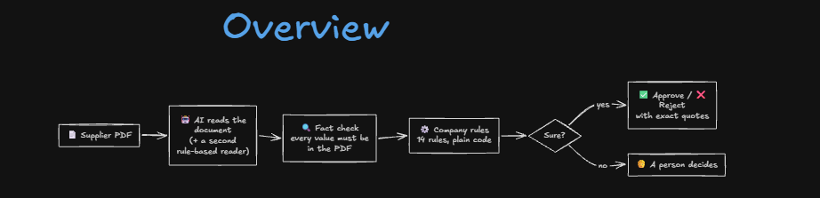
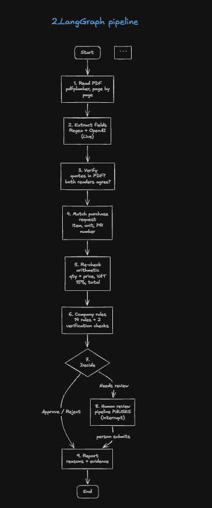
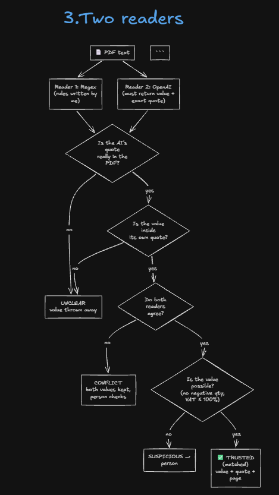
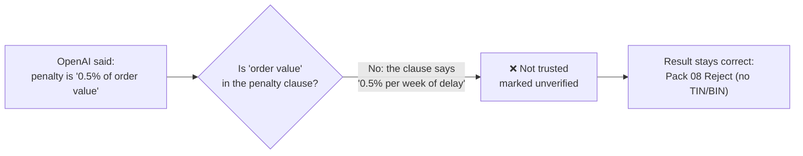
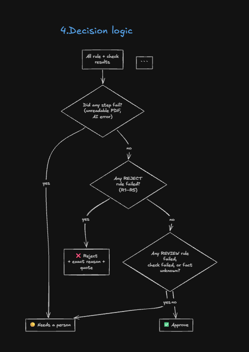
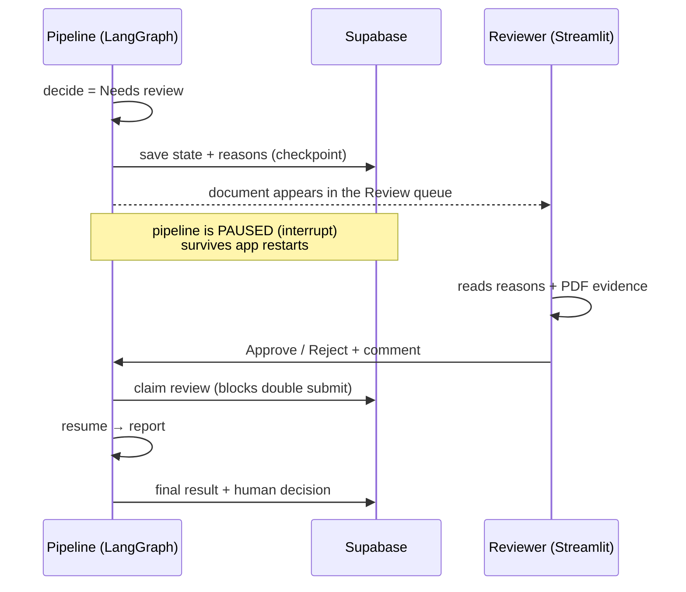
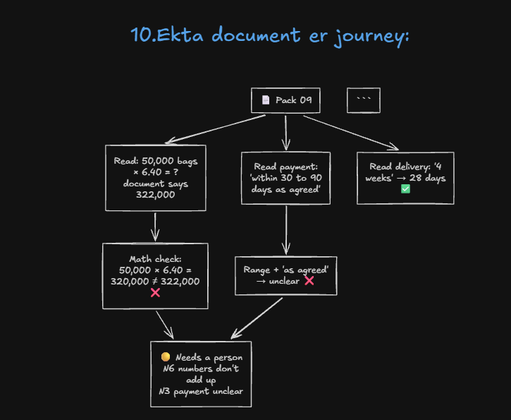
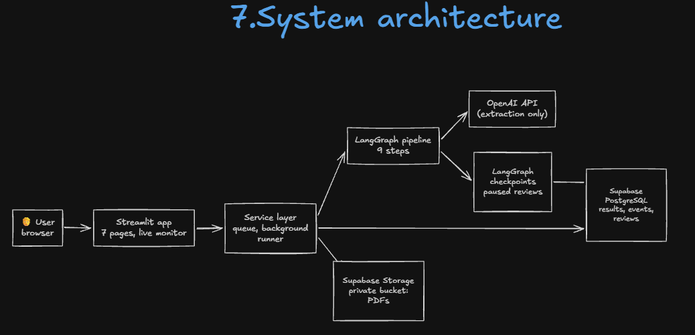
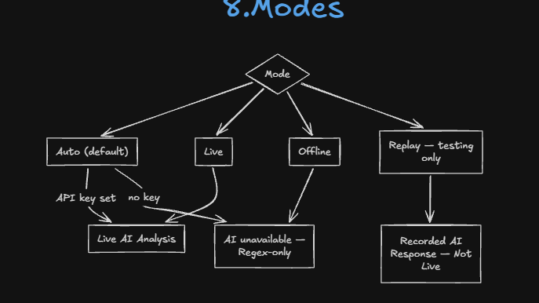
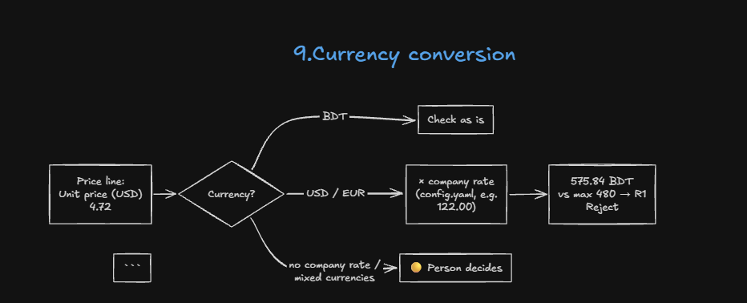

# Supplier Quote Checker

**An AI pipeline that checks supplier quotations against the purchase request and the company rules, and
decides _Approve_, _Reject_ or _Needs a person to check_, quoting the exact text from the PDF behind every
reason.**

[](https://supplier-quote-checker-6dxzcg8emkywq5yadryrph.streamlit.app/)


| | |
|---|---|
| 🌐 **Live app** | **https://supplier-quote-checker-6dxzcg8emkywq5yadryrph.streamlit.app/** |
| 🛠️ **Setup & run guide** | [SETUP.md](SETUP.md): requirements, installation, configuration, tests, deployment |
| 📝 **One-page note** | [NOTE.md](NOTE.md): what it does, tests, results, what does not work well, next steps |

> **AI reads. Code decides. When anything is unclear, a person decides.**

---

## Contents

1. [Overview](#1-overview)
2. [Results](#2-results)
3. [How it works](#3-how-it-works)
4. [Never guess: two readers and a fact check](#4-never-guess-two-readers-and-a-fact-check)
5. [Decision logic and business rules](#5-decision-logic-and-business-rules)
6. [Human review](#6-human-review)
7. [Example: one document's journey](#7-example-one-documents-journey)
8. [System architecture](#8-system-architecture)
9. [Processing modes](#9-processing-modes)
10. [Currency conversion](#10-currency-conversion)
11. [The web app](#11-the-web-app)
12. [Getting started](#12-getting-started)
13. [Project structure](#13-project-structure)
14. [Assumptions](#14-assumptions)
15. [Limitations and next steps](#15-limitations-and-next-steps)

---

## 1. Overview

A garment company (Aamar Garments Ltd, fictional) receives quotations and contract terms from suppliers every
day. Each one must be checked against the purchase request and the company rules: price, quantity, payment
terms, delivery, VAT, tax registration and late-delivery penalties. By hand this is slow and error-prone.

For every supplier PDF the checker:

1. **reads** the quote: supplier, item, quantity, price, delivery period, payment terms, VAT, TIN/BIN, penalty
   clause and validity (24 fields);
2. **compares** it with the purchase request (item, unit, quantity, maximum price);
3. **re-checks the arithmetic** (quantity × price, subtotal, VAT, total);
4. **applies the company rules** ([data/company-rules.md](data/company-rules.md));
5. **decides** and explains why, quoting the exact text that supports each reason;
6. **stops and asks a person when it is not sure.** It never guesses.



---

## 2. Results

### The 10 sample packs

| Pack | Supplier | Decision | Reason |
|---|---|---|---|
| 01 | Padma Textile Mills Ltd | ✅ Approve | All rules pass |
| 02 | Jamuna Trims and Accessories | ✅ Approve | All rules pass |
| 03 | Karnaphuli Yarn Traders | ❌ Reject | R1: price 229.00 is 9.05% above max 210.00 |
| 04 | Surma Packaging Industries | 🟡 Needs a person | N1: price 6.65 is 2.31% above max 6.50 |
| 05 | Meghna Carton Works | ❌ Reject | R2: 40% advance (wording duplicated; every reading > 20%) |
| 06 | Teesta Fabrics Ltd | ❌ Reject | R3: no late-delivery penalty clause |
| 07 | Rupsha Zipper Factory | 🟡 Needs a person | N2: quantity 16,500 vs 20,000 requested (−17.5%) |
| 08 | Bhairab Thread and Co | ❌ Reject | R4: TIN/BIN missing ("available on request") |
| 09 | Dhaleshwari Poly Pack | 🟡 Needs a person | N6: line amount wrong by 2,000; N3: payment "30 to 90 days as agreed" |
| 10 | Kushiyara Box Industries | ❌ Reject | R5: delivery 60 days; N5: VAT not shown separately |

### Accuracy

| Mode | Decision right | Decision **and** reason right | Avg time / pack |
|---|---|---|---|
| Live: OpenAI `gpt-4o-mini` + regex cross-check (2 runs) | **10/10** | **10/10** | ~7 s |
| Offline: regex only | **10/10** | **10/10** | ~0.1 s |
| Offline, 20 extra generated test packs (boundaries, wording, corrupted, scanned) | **20/20** | **20/20** | ~0.1 s |

A pack only counts as right when the decision matches **and** every expected rule is among the reasons, so a
right answer for the wrong reason does not count. The project also has **200+ automated tests**, including 9
PDF layouts the extractor was not written for.

---

## 3. How it works

A **fixed pipeline of nine steps** built with LangGraph, not a free-running agent. Every step does one job,
writes its result into the shared state and can be tested on its own. If a step fails, the error is recorded,
the remaining steps are skipped and the document goes to a person.



| # | Step | File | What it does |
|---|---|---|---|
| 1 | Read | [checker/parse.py](checker/parse.py) | PDF → text, page by page, with pdfplumber |
| 2 | Extract | [checker/extract_llm.py](checker/extract_llm.py), [checker/extract_regex.py](checker/extract_regex.py) | OpenAI returns structured JSON (value + **exact quote** + status per field). A regex extractor reads the same document independently. |
| 3 | Verify | [checker/verify.py](checker/verify.py) | Trusts a value only if its quote is in the PDF, the value is in its quote, and both readers agree |
| 4 | Match | [checker/match.py](checker/match.py) | Finds the purchase-request line; checks item, unit and PR number |
| 5 | Maths | [checker/math_check.py](checker/math_check.py) | Quantity × price, subtotal, VAT, total, all with `Decimal` |
| 6 | Rules | [checker/rules.py](checker/rules.py) | 14 company rules + 2 verification checks; each returns PASS / FAIL / UNKNOWN with evidence |
| 7 | Decide | [checker/decide.py](checker/decide.py) | Reject > Needs a person > Approve |
| 8 | Human review | [checker/graph.py](checker/graph.py) | LangGraph `interrupt()` pauses the pipeline until a person answers |
| 9 | Report | [checker/report.py](checker/report.py) | Result with reasons, quotes and a financial summary |

### Design principles

- **The LLM only reads.** Language models are good at messy text and bad at arithmetic and at noticing what is
  missing. Every comparison and every rule is plain Python; the LLM is never asked "should we approve this?".
- **"Never guess" is enforced in code, not only in the prompt.** A value with no quote, a quote that is not in
  the PDF, or a disagreement between the two readers becomes UNCLEAR, and UNCLEAR can never lead to Approve.
- **A failed step never crashes a run.** It is recorded and the document goes to a person. Even a clear Reject
  goes to a person if the AI step failed, because only one reader was used.
- **Rules are configuration.** Every threshold lives in [config.yaml](config.yaml); changing a company rule is
  a one-line edit.

---

## 4. Never guess: two readers and a fact check

The hardest part of the problem: an LLM will confidently make things up. So two independent readers extract
every field, and a value is **trusted only if it survives every check**:



This catches real mistakes. In live runs the AI claimed that pack 08's penalty is "% of order value" (the
clause does not say so) and reported a subtotal for pack 10, which has none. Both were caught and discarded,
and the decisions stayed correct:



With the first prompt version the LLM also made up quotes such as `"Qty 800"` by joining a column header to a
value. These were rejected too: the score was 8/10, with 2 clean packs sent to a person, never wrongly
approved.

Conflicting readings are never resolved silently: every candidate value is kept with its source and quote, and
shown to the reviewer.

---

## 5. Decision logic and business rules



**Approve is the hardest answer to get:** every rule must pass **and** every important fact must be verified.
Missing information can never approve.

### The 14 rules and 2 verification checks

| Type | ID | Rule |
|---|---|---|
| ❌ **Reject** | R1 | Unit price more than 3% above the maximum |
| | R2 | Advance payment more than 20% |
| | R3 | No late-delivery penalty clause |
| | R4 | Supplier TIN or BIN missing |
| | R5 | Delivery later than 45 days after the purchase order |
| 🟡 **Needs a person** | N1 | Unit price above the maximum, by no more than 3% |
| | N2 | Quantity differs from the request by more than 5% |
| | N3 | Payment terms unclear, or outside 30–60 days after delivery |
| | N4 | Delivery in 31–45 days |
| | N5 | VAT not shown separately at 15% |
| | N6 | Numbers do not add up |
| | N7 | Quotation valid for less than 30 days |
| | P1 | Penalty below 0.5% of order value per week |
| | X1 | Quote does not match the purchase-request line |
| 🔍 **Verification** | V1 | Mandatory facts (supplier, quotation no. and date, item, quantity, price, total) found and verified |
| | V2 | No conflicting or implausible values |

---

## 6. Human review

When the decision is *Needs a person*, the pipeline **pauses** and waits. The reviewer sees the reasons and the
evidence from the PDF, approves or rejects with a comment, and the same paused pipeline resumes and finishes
the report. The paused state is stored, so a review survives app restarts.



---

## 7. Example: one document's journey

Pack 09 (Dhaleshwari Poly Pack) goes to a person for two independent reasons, each backed by a quote:



---

## 8. System architecture



| Layer | Technology | Responsibility |
|---|---|---|
| Web app | Streamlit (7 pages), Plotly | Queue, live monitor, results, human review, history, settings |
| Service layer | Python ([service/](service/)) | Document queue, background batch runner, history store, file storage. No Streamlit code. |
| Pipeline | LangGraph ([checker/](checker/)) | The 9 steps; all business logic |
| AI | OpenAI `gpt-4o-mini`, structured output | Field extraction only |
| Database | Supabase PostgreSQL (local: SQLite) | Results, events, step checkpoints, reviews, LLM cache |
| Files | Supabase Storage, private bucket (local: folder) | Original PDFs, content-addressed by SHA-256 |

---

## 9. Processing modes



| Mode | What reads the document | Labelled as | API key |
|---|---|---|---|
| `auto` (default) | Live AI if an OpenAI key is set, otherwise regex only. Never uses recorded responses. | Live AI Analysis / AI unavailable — Regex-only analysis | optional |
| `live` | A real OpenAI call per document + regex cross-check. Without a key, or if the call fails, it falls back to regex only and the document goes to a person. | Live AI Analysis | yes |
| `regex` (Offline) | Regex extractor only, no network | AI unavailable — Regex-only analysis | no |
| `replay` (**testing only**) | Recorded OpenAI responses + regex cross-check; chosen explicitly only | Recorded AI Response — Not Live | no |

Every result records how it was produced and the app shows it as a badge, so a recorded response is never
presented as live AI. A recording is matched by the exact document text and prompt version, so it can never be
reused for a different PDF. Every step after extraction runs again in every mode.

---

## 10. Currency conversion



Prices in another currency (USD, EUR, …) are converted to BDT with the **company's fixed rate** from
[config.yaml](config.yaml), never a rate from the supplier's document or the internet. The report shows the
quoted amount, the rate and the BDT value. A currency without a company rate, or mixed currencies, goes to a
person.

---

## 11. The web app

**Live:** https://supplier-quote-checker-6dxzcg8emkywq5yadryrph.streamlit.app/

| Page | What it shows |
|---|---|
| **Overview** | Totals, approve / reject / review counts, success rate, average time, recent activity and charts |
| **Document Processing** | Add the samples or upload PDFs → validated queue → **Start processing** → live monitor |
| **All Documents** | Every document: decision, evidence quotes, all 24 fields with their source, every rule, extracted text, PDF preview, processing log |
| **Validation Results** | Rule matrix (documents × rules) and rule-failure chart per batch |
| **Human Review** | Documents the system would not decide; approve or reject with a reason to resume the paused pipeline |
| **Processing History** | Past batches and documents, filterable by date, supplier, decision, mode and status |
| **Settings** | Processing mode, OpenAI connection test, rule thresholds, storage status, clear history |

**Live monitor.** A background thread processes the batch one document at a time, so the app stays usable.
Progress comes from LangGraph's own task stream: each stage on screen is exactly one graph node, so nothing is
simulated. **Cancel** stops after the current document; a failed document is recorded at the stage where it
failed, and the batch continues.

**Persistence.** With Supabase configured, history, events, paused reviews and the original PDFs are permanent.
Without it everything is stored locally under `runtime/`. Work interrupted by a restart is marked *interrupted*
and can be re-queued from Processing History.

---

## 12. Getting started

### Requirements

| | |
|---|---|
| **Required** | Python 3.10+ (3.12 recommended), pip, git |
| Optional | OpenAI API key (live AI extraction; without it the app runs offline) |
| Optional | Supabase project (permanent storage; without it storage is local) |

### Quick start

```bash
git clone https://github.com/shamiulriyad/supplier-quote-checker.git
cd supplier-quote-checker
pip install -r requirements.txt

python evaluate.py --mode regex   # offline check on the 10 samples, no key needed → 10/10
streamlit run app.py              # web app on http://localhost:8501
python -m pytest -q               # 200+ tests, no credentials needed
```

To use OpenAI, copy `.env.example` to `.env` and set `OPENAI_API_KEY`.

**➡️ Full instructions in [SETUP.md](SETUP.md):** virtual environment, every environment variable, rule
configuration, command-line tools, Supabase setup, Streamlit Cloud deployment, security and troubleshooting.

---

## 13. Project structure

```
supplier-quote-checker/
├── app.py               Streamlit entry point: page setup and navigation
├── checker/             business logic: one file per pipeline step + graph.py (LangGraph wiring)
├── service/             queue, batch runner, progress events, history store, database + file storage (no Streamlit)
├── ui/                  Streamlit theme, sidebar, shared components, charts, one module per page (ui/pages/)
├── data/                10 sample packs, purchase request, company rules
├── supabase/            SQL migrations (schema, Row Level Security, private bucket)
├── tools/               supabase_setup.py, migrate_local_history.py
├── tests/               pytest suite, answer key (expected.csv), unseen-layout PDF fixtures
├── docs/                full design notes (design-notes.md), architecture audit, Supabase migration
├── assets/diagrams/     documentation diagrams
├── config.yaml          rule thresholds, model, mode, exchange rates
├── run.py               command-line runner
├── evaluate.py          scores results against tests/expected.csv
├── README.md            this file
├── SETUP.md             setup, run and deployment guide
└── NOTE.md              one-page note (what, tests, results, limits, next)
```

Created at run time and not in git: `runtime/` (local history, review checkpoints, PDFs), `cache/llm/` (new
OpenAI answers), `outputs/` (CLI reports).

---

## 14. Assumptions

Where the company rules are not explicit:

| Situation | What the checker does |
|---|---|
| Exactly 3% over price, exactly 20% advance, exactly 45 days, exactly 30 days validity | Allowed ("more than" / "less than" are strict) |
| Penalty present but below 0.5% per week, or not stated as % of order value | Needs a person (P1) |
| Price quoted including VAT (pack 10) | Compared as quoted (the stricter reading) and flagged under N5 |
| "4 weeks" | 28 days |
| Payment "30 to 90 days as agreed" | Unclear → Needs a person |
| Advance stated twice (pack 05: 40% + 40%) | Unclear, but Reject because even the lowest reading (40%) is over 20% |
| Document with no item line at all | Needs a person (not Reject): it may not be a quotation |

---

## 15. Limitations and next steps

| Limitation | Effect today | Next step |
|---|---|---|
| Text PDFs only (no OCR) | Scanned PDFs go to a person | Add OCR |
| One item per quotation | Multi-item quotes go to a person | Line-item support |
| Regex reader tuned to common layouts | Very unusual layouts go to a person (safe, but more manual work) | Test on real supplier quotes |
| No login | Everyone using a deployment shares one history | Supabase Auth + per-user Row Level Security |
| One batch at a time per server | Batches queue behind each other | Worker queue |

More detail in [NOTE.md](NOTE.md) and [docs/design-notes.md](docs/design-notes.md).

---

<sub>MIT License · © 2026 Riyad</sub>
